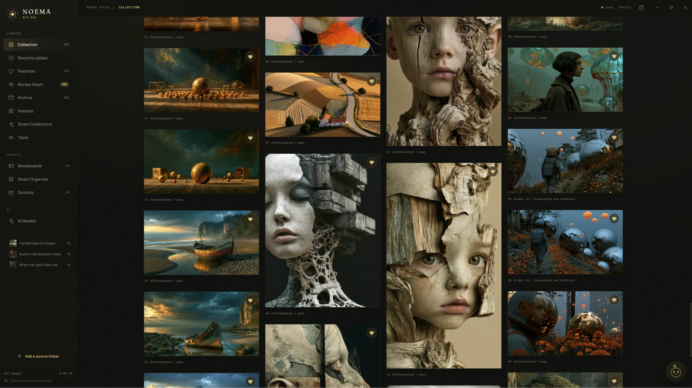
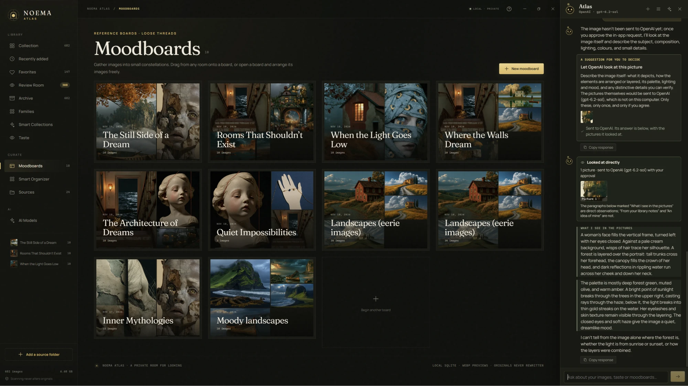
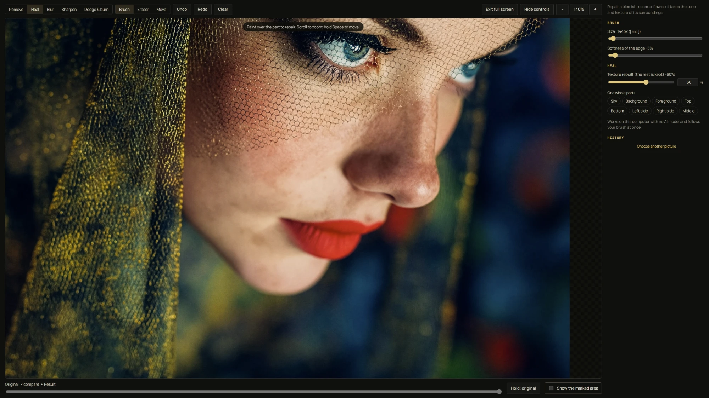
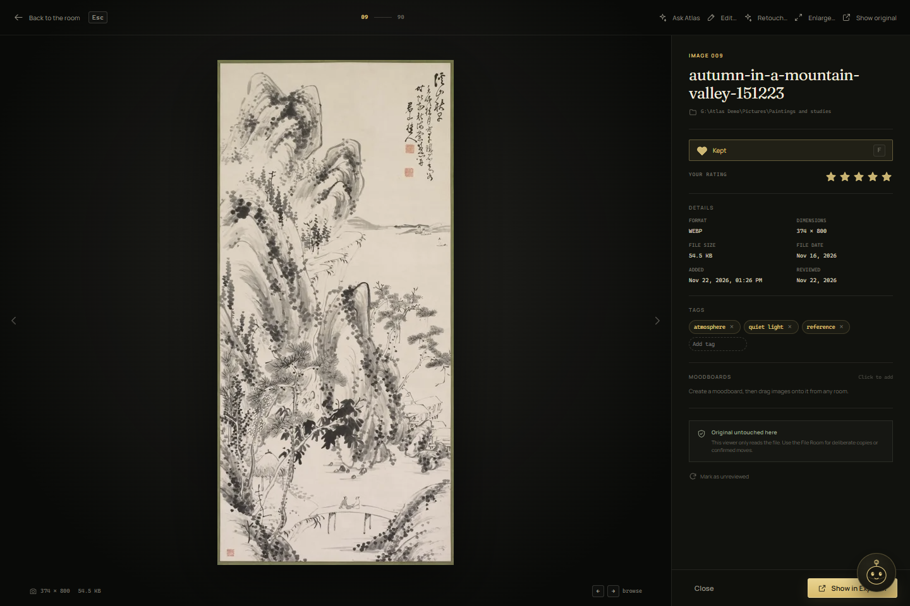
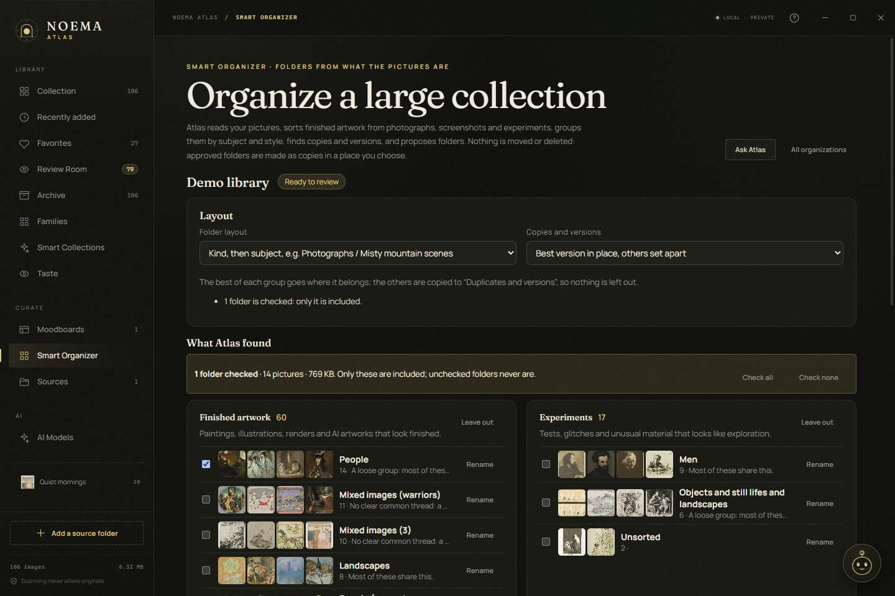
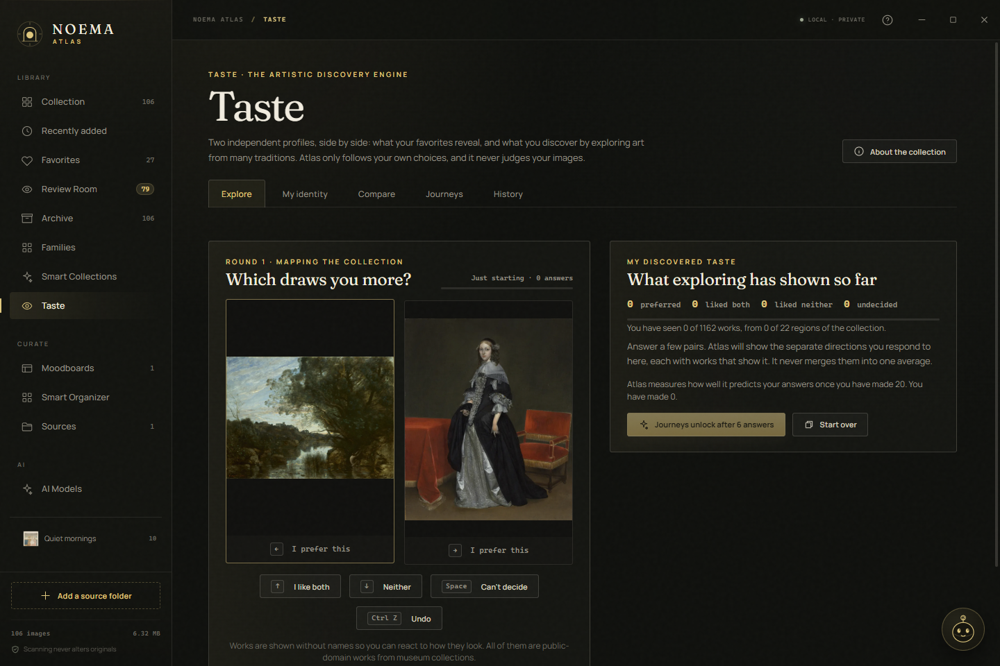
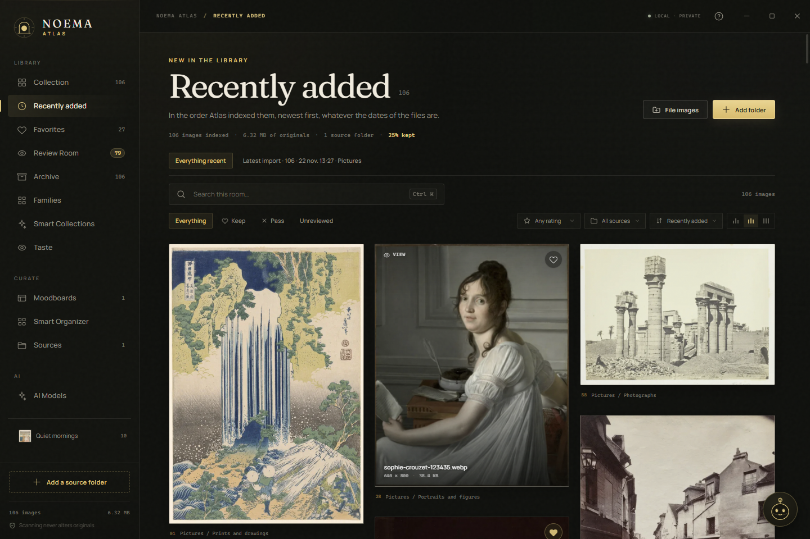

# NOEMA Atlas

**A quiet, private home for the images that stay with you.**
Organize, discover, arrange and refine your pictures on your own computer — your originals stay untouched.

<p align="center">
  
</p>
<p align="center"><em><strong>The Collection</strong> — your creative library, beautifully organized.</em></p>

NOEMA Atlas is a free Windows desktop application for artists, photographers and collectors. Point it at your folders and it builds a fast, private
library: review and keep your best pictures, sort a messy collection into folders, find duplicates, arrange moodboards, discover art, and retouch details
without changing the original. Optional AI that runs on your own computer can search by what pictures look like. It works offline, needs no account and
does not track you.

**New here?** Read the **[User Manual](docs/USER-MANUAL.md)** for installation, first steps and every feature in plain language.

> **Status:** first public release, version 1.0.0, Windows 11 (64-bit). The program is **not code-signed**, so Windows shows a one-time warning (see below).

## See Atlas

### 1. The Collection


**Your creative library, beautifully organized.** Explore, review and curate your artwork and photographs in one visual workspace. Rediscover your images and keep your collection organized.

### 2. Creative Moodboards



**Turn your images into new creative directions.** Bring pictures together, explore visual connections and develop ideas through freely arranged moodboards.

### 3. Precision Retouching



**Refine the details. Preserve the original.** Remove unwanted details, heal imperfections, soften, sharpen and adjust light with intuitive local tools. Compare your changes while keeping the original untouched.

*These three screenshots show the author's own AI-generated artworks. The images in the manual and below use public-domain museum works.*

## Download and install

1. Open the **[Releases](https://github.com/Kirtap72/NOEMA-Atlas/releases/latest)** page (or [download directly](https://github.com/Kirtap72/NOEMA-Atlas/releases/download/v1.0.0/NOEMA-Atlas-1.0.0-portable.exe)).
2. Download **`NOEMA-Atlas-1.0.0-portable.exe`** (about 200 MB). There is no installer: put the file anywhere and double-click it.
3. If Windows says **"Windows protected your PC"**, click **More info → Run anyway**. This appears because the file is not signed.
4. The first start takes a few seconds while Windows unpacks the program.

To check your download, compare its SHA-256 with the one on the Releases page (`Get-FileHash .\NOEMA-Atlas-1.0.0-portable.exe` in PowerShell).

Your library is stored separately in `%APPDATA%\NOEMA Atlas`, so it survives updates. To uninstall, delete the file (and that folder if you want everything gone).

**Requirements:** Windows 11, 64-bit; about 250 MB free space (plus 390 MB if you choose the optional local AI model). A graphics card is optional.
The optional AI search needs Microsoft's [Visual C++ Redistributable (x64)](https://learn.microsoft.com/en-us/cpp/windows/latest-supported-vc-redist) if it is not already installed.

## What you can do

- **Review and keep.** The Review Room shows one picture at a time: keep, pass or rate, with unlimited undo. Favorites, stars and tags live in your own library.
- **Find new imports.** **Recently added** lists pictures in the order Atlas found them; choose *Latest import* to see one batch. New files in watched folders are noticed automatically.
- **Search.** By file name, folder and tag; with the optional AI also by *what a picture looks like* (English or Swedish).
- **Find pictures on this computer.** A read-only search of your drives for folders of images, with previews before anything is added.
- **Organize with the Smart Organizer.** Atlas proposes folders from what your pictures are and finds copies and versions. **You tick the groups you want; only ticked groups are included, and nothing ticked means nothing is selected.** Then **Copy** them to a folder, or **Move** them — Atlas keeps favorites, ratings, tags, moodboards and version links, checks every file, never overwrites, and can continue after an interruption. A full preview comes first.
- **Moodboards.** Open canvases with zoom, pan, tidy and undo.
- **Taste.** Compare works from a built-in collection of 1,162 public-domain artworks and see two honest profiles of what draws you.
- **Creative Studio and Retouch.** Create artwork from a moodboard; edit by description; retouch with a brush; edit in another program and bring the result back as a linked version.
- **The Atlas Companion.** Finds pictures by description, suggests moodboards, plans an organization — and **never changes anything by itself**: it proposes, you decide.

### More of Atlas

| | |
|---|---|
|  |  |
| **Look closely, decide calmly.** Keep, rate and tag; the viewer only reads the file. | **Put a large library in order — only as far as you choose.** Tick the groups to copy or move. |
|  |  |
| **Find out what draws you.** Compare works from a public-domain collection. | **Find what you just imported.** Newest first, one import at a time. |

## Your originals are safe

- Scanning, previews, search and curation only **read** your files.
- Atlas moves files **only** when you choose **Move** (in the File Room or the Smart Organizer), after a preview and confirmation. It then updates the library to follow the file.
- It never overwrites: a name that is taken gets a number, and a different file at the destination is left alone.
- Removing a source forgets only Atlas's notes about those pictures; the files stay on disk.
- It still pays to keep your own backups. See the manual's chapter on backup and restore.

## Optional AI — off until you choose it

- **Local image model** (about 390 MB, downloaded once from Hugging Face after you press the button): enables search by look, Families, Smart Collections and the Smart Organizer's subject grouping. It runs on your computer; pictures are never uploaded.
- **Companion language model** (optional): connect a model on your own computer (Ollama, LM Studio, …) or your own cloud account. Atlas first shows what would be shared (text descriptions, never picture files unless you approve those pictures) and asks.
- **ComfyUI** and **paid cloud picture generation** (optional): ComfyUI is used from *your own* installation, read-only; paid services show the price first and ask each time.
- **AI Model Library:** says honestly whether a model fits this computer and whether Atlas has tested it.

## Privacy

No account, no ads, no tracking, no uploads of your pictures. By default the only network use is the optional model download that you start. Anything else
(a cloud model, a network server, paid generation) happens only if you connect it and agree. Crash notes stay on your computer. The optional Windows AI runtime
includes Microsoft diagnostics, which Atlas switches off before loading it; no packet-level inspection was made, so no stronger claim is made here.

## Known limitations

- **Unsigned** download: Windows shows a SmartScreen warning.
- Tested on **one Windows 11 computer** (NVIDIA RTX 2080, 32 GB). Not tested: other hardware, fresh or company-managed Windows, huge libraries (hundreds of thousands of pictures), very large single images, disconnecting network or removable drives during a move.
- Optional AI: **AMD/Intel graphics, RTX 50-series and Windows on Arm are untested.** Names and groups made by the AI are suggestions and can be wrong; each can be renamed.
- **Cloud — what was and was not tested.** *Tested:* the Companion looking at pictures you approve, through your own **OpenAI** account (a real OpenAI model, with the consent step; the Moodboards screenshot above shows it), plus automated tests of the consent and privacy rules. *Not tested:* **paid cloud picture generation** (OpenAI image models in the Creative Studio) — only the request format, price display and monthly limit were checked by automated tests; no live paid job was run. Other cloud language-model providers were not tried individually.
- **Adobe Photoshop** was **not** tested (GIMP was, for "edit in another program"). ComfyUI was tested with a real model on one graphics card and with a stand-in server.
- One automated Retouch test that runs a real ComfyUI removal on the graphics card crashed its test page once during release testing while the computer was heavily loaded, then passed on the next run (and on the previous candidate). The cause was not established; it did not reproduce, and no original picture was affected. If Remove with ComfyUI ever closes the window, please report it.
- Some full-size edits use a lot of memory on very large pictures.
- In-app text on the Smart Organizer and Sources pages still describes filing as copy-only in places; Move exists in both the File Room and the Smart Organizer.
- Atlas is a first release. Please report problems with the exact steps.

## Documentation

- **[User Manual](docs/USER-MANUAL.md)** — installation, first launch, setup, discovery, organizing, copying and moving, creative features, optional AI, backup, troubleshooting.
- [Smart Organizer](docs/ORGANIZER.md) · [Creative Studio and Retouch](docs/STUDIO.md) · [Companion](docs/ASSISTANT.md) · [AI Model Library](docs/MODEL-LIBRARY.md) · [ComfyUI](docs/COMFYUI_COMPONENT.md)
- [Artistic discovery](docs/ARTISTIC-DISCOVERY.md) · [Taste](docs/TASTE-ARCHITECTURE.md) · [Reference collection](docs/REFERENCE-COLLECTION.md)

## Build from source

Requires Node.js 24 or later on Windows.

```powershell
npm install
npm run dev          # run in development
npm test             # unit and integration tests
npm run build        # type-check and build
npm run package      # build the portable Windows executable into release\
```

If Electron's runtime is missing after `npm install`, run `node node_modules\electron\install.js` first.
The end-to-end scripts in `scripts\` drive the real application (for example `node scripts\e2e-organizer.mjs --exe "release\win-unpacked\NOEMA Atlas.exe"`).

```
src/main/      Electron main process: database, scanner, organizer, studio, assistant, model library
src/preload/   the small, typed bridge to the window
src/renderer/  the React interface
src/shared/    types shared by both sides
tests/         unit and integration tests (Vitest)
reference/     the Atlas Reference Collection (1,162 public-domain works, credits, embeddings)
scripts/       development launcher and end-to-end checks
build/         icons and bundled third-party notices
```

## Licence and credits

**Copyright © 2026 Patrick Karlsson.** NOEMA is the project and product name. NOEMA Atlas is released under the **MIT licence** (see `LICENSE`). It bundles other software and data under their own terms — Electron and Chromium, ONNX Runtime and
DirectML, sharp and libvips, React, the Fraunces and Manrope fonts, and the reference artworks from the Cleveland Museum of Art and the Art Institute of Chicago
(open access, CC0). See **[THIRD-PARTY-NOTICES.md](THIRD-PARTY-NOTICES.md)** and the files in `build/third-party/`. Atlas is not affiliated with these organisations.
