# NOEMA Atlas — User Manual

*For Windows 11 (64-bit). Written for people who make, collect or look at images; no technical knowledge needed.*

**Contents**

1. [What Atlas is](#1-what-atlas-is)
2. [Installing and starting](#2-installing-and-starting)
3. [Setting up your library](#3-setting-up-your-library)
4. [Looking at and sorting your pictures](#4-looking-at-and-sorting-your-pictures)
5. [Finding pictures you did not know you had](#5-finding-pictures-you-did-not-know-you-had)
6. [Organizing: moodboards, groups, copying and moving](#6-organizing-moodboards-groups-copying-and-moving)
7. [Creative features](#7-creative-features)
8. [Optional AI: what it is and how to set it up](#8-optional-ai-what-it-is-and-how-to-set-it-up)
9. [Backup, restore and moving to another computer](#9-backup-restore-and-moving-to-another-computer)
10. [Troubleshooting](#10-troubleshooting)
11. [Privacy in plain words](#11-privacy-in-plain-words)
12. [Keyboard shortcuts](#12-keyboard-shortcuts)
13. [What has been tested, and the limits](#13-what-has-been-tested-and-the-limits)

---

## 1. What Atlas is

NOEMA Atlas is a **private picture library that lives on your own computer**. You point it at the folders where your photographs, scans,
AI images and visual references already are. Atlas makes small previews, remembers what you think of each picture, and helps you
find, sort, compare and build on them. Your original files stay exactly where they are.

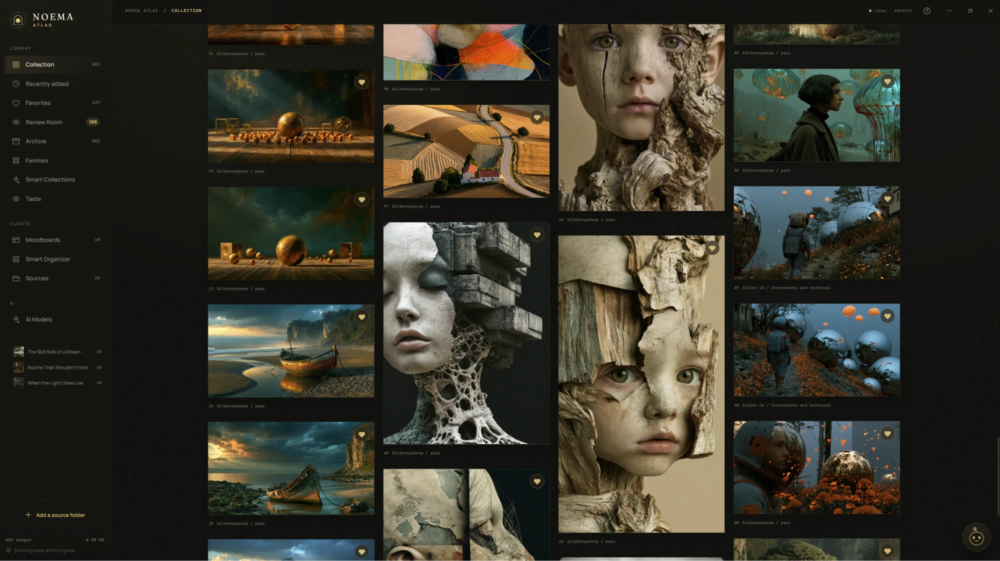

**The Collection — your creative library, beautifully organized.** Explore, review and curate your artwork and photographs in one visual workspace.
*(The first three screenshots in this manual show the author's own AI-generated artworks. The others use public-domain museum works.)*

Atlas is for you if you:

- have thousands of images spread over folders and drives, and cannot find the good ones any more;
- make moodboards or collect references;
- want a quiet way to decide what to keep;
- would like help sorting a messy folder, finding duplicates, or retouching a picture without opening a big editor.

Atlas works fully **without an internet connection and without any AI**. AI is an optional extra (chapter 8).

---

## 2. Installing and starting

### What you need

- A Windows 11 computer, 64-bit. (Atlas was built and tested on Windows 11. Other versions of Windows have not been tested.)
- About 250 MB of free space for the program, plus room for previews (small) and, if you choose them, optional AI models (from 390 MB).
- A graphics card is *not* required. If you have one, the optional AI search uses it to be faster.

### Installing

There is no installer. Atlas is one file:

1. Download **`NOEMA-Atlas-1.0.0-portable.exe`** from the project's *Releases* page.
2. Put it anywhere you like (for example a folder called `Atlas`, or your desktop).
3. Double-click it. The first start takes a few seconds while Windows unpacks the program; later starts are quicker.

To check that the download is complete and unchanged, you can compare its fingerprint (SHA-256) with the one on the Releases page. In
PowerShell: `Get-FileHash .\NOEMA-Atlas-1.0.0-portable.exe`.

### Windows may warn you

The program is **not digitally signed** (signing costs money and is not done for this first release). Windows therefore shows a blue
**SmartScreen** window, "Windows protected your PC".

1. Click **More info**.
2. Click **Run anyway**.

This is expected for a new, unsigned program. If you are unsure, check the fingerprint first, or ask the person who gave you the file.

If Windows says a file such as `VCRUNTIME140.dll` is missing, install Microsoft's free
[Visual C++ Redistributable (x64)](https://learn.microsoft.com/en-us/cpp/windows/latest-supported-vc-redist) and start Atlas again.
(Atlas itself opens without it; only the optional AI search needs it.)

### Uninstalling

Delete the file. Your library data is kept separately (see chapter 9). To remove everything, also delete the folder
`%APPDATA%\NOEMA Atlas` (type that into the Explorer address bar).

---

## 3. Setting up your library

### The first screen

When Atlas starts for the first time the library is empty, and it invites you to choose a folder.

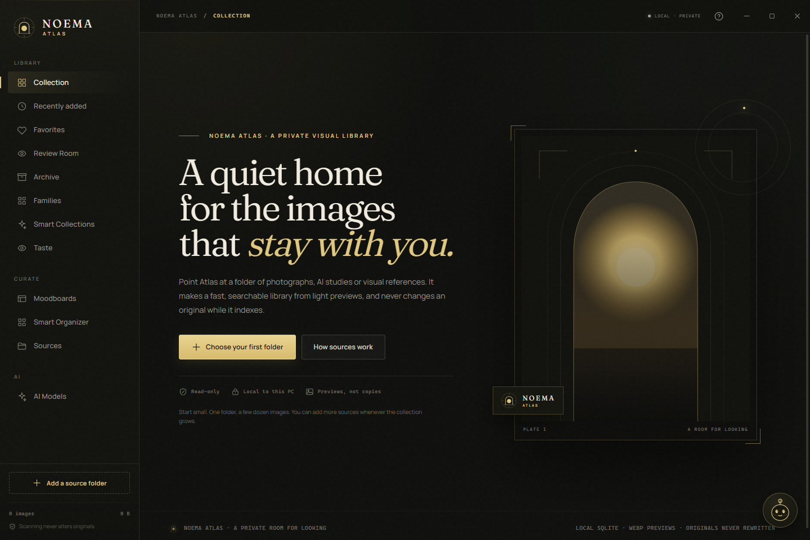

### Add a source folder

A **source** is a folder Atlas may *read*. It never changes, moves or deletes the pictures in it while it looks at them.

1. Click **Choose your first folder** (or **Add a source folder** at the bottom of the left menu, or press `Ctrl+O`).
2. Pick one folder. **Start small**: one project folder or a few dozen pictures. You can add more whenever you like.
3. Atlas reads the folder, including sub-folders, and makes small previews. A progress card shows how far it has come. You can use
   Atlas while it works.

Atlas refuses to add a whole drive (for example `C:\`) on its own; it only reads folders you choose.

Supported formats: JPG, PNG, WebP, GIF, BMP, TIFF, AVIF and SVG. Some others (HEIC, JXL) are catalogued when Windows can preview them. A
picture that cannot be previewed is still listed, with a note, and you can open the original from there.

### The sources page

The **Sources** page lists what Atlas reads. From here you can **Rescan** a folder, stop a scan, remove a source, or open Atlas's data folder.

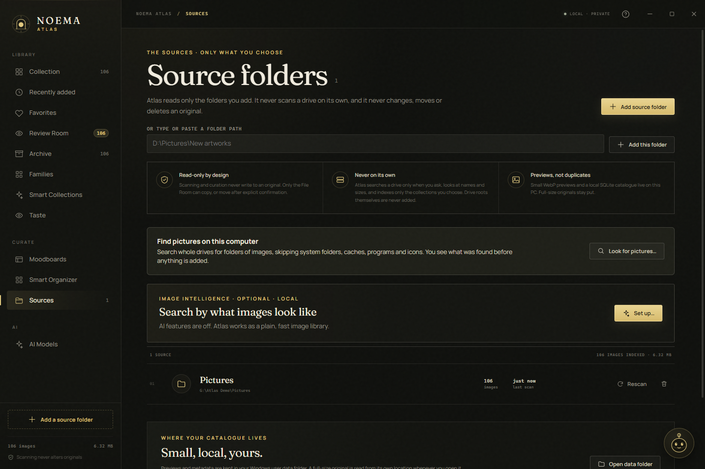

*Removing a source forgets only Atlas's own notes about those pictures (ratings, tags, moodboard places). Your picture files are never deleted.*

### New pictures are noticed automatically

When you add pictures to a source folder, Atlas notices a few seconds after the files have finished copying and adds them. If a folder
cannot be watched (a disconnected drive, some network folders), press **Rescan** on the Sources page.

### The one-time AI question

After your first folder, Atlas asks once whether you want it to learn what your pictures look like.

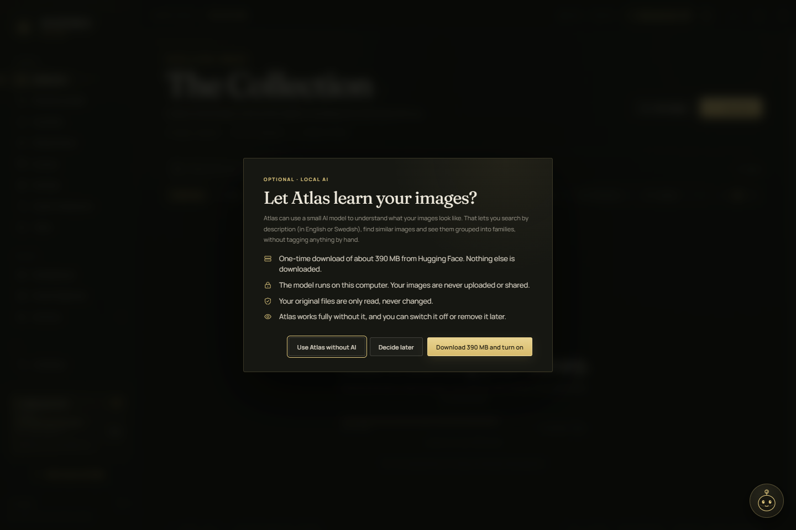

- **Use Atlas without AI** — nothing is downloaded. Everything except description search, "families" and a few extras works as normal.
- **Download 390 MB and turn on** — downloads a small AI model once, from Hugging Face. It then runs on your computer; your pictures
  never leave it.
- **Decide later** — ask again another time. You can change your mind at any time in **Sources → Image intelligence**.

Nothing is downloaded until you press the download button.

---

## 4. Looking at and sorting your pictures

The left menu has these rooms:

| Room | What it is for |
|---|---|
| **Collection** | Your library, with your favorites and best-rated pictures first. Filter by Keep, Pass, Unreviewed and stars. |
| **Recently added** | New pictures in the order Atlas found them, newest first. Pick **Latest import** to see one import as a collection. |
| **Favorites** | The pictures you decided to keep. |
| **Review Room** | One picture at a time: keep, pass or rate. A calm way to sort a big backlog. |
| **Archive** | Everything, including passed and missing pictures, as a searchable list. |
| **Families**, **Smart Collections** | Groups by look (needs the optional AI). See chapter 8. |
| **Taste** | Discover art you may like (chapter 7). |
| **Moodboards**, **Smart Organizer**, **Sources** | Chapter 6. |

### Opening a picture

Click any picture to see it large. On the right you can **Keep** it (heart), give it **1–5 stars**, add **tags**, see its size and
where it is, put it on a moodboard, or press **Show in Explorer**. Use the arrow keys to move between pictures and `Esc` to go back. The
viewer only reads the file.

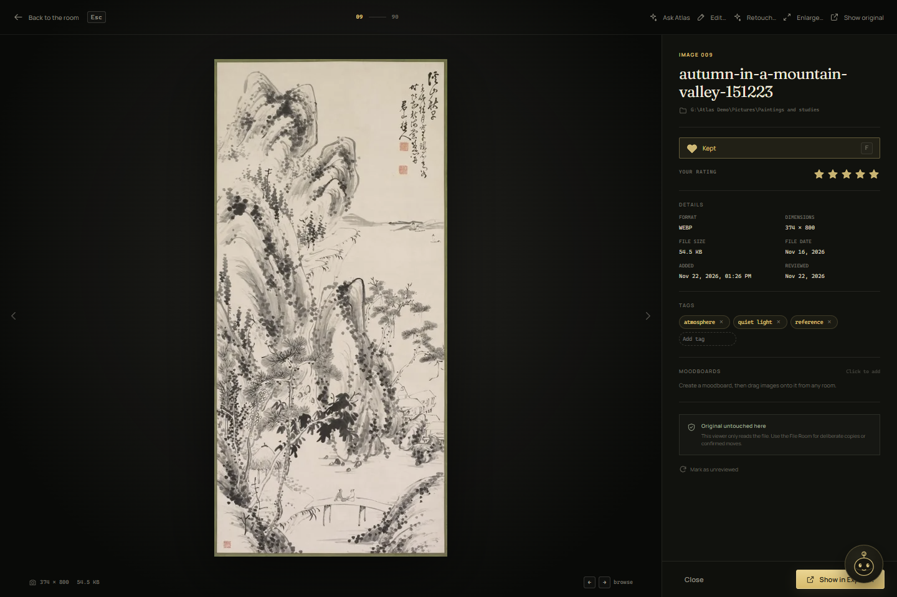

### The Review Room

Open **Review Room** and press `F` to keep, `X` to pass, or `1`–`5` to rate. `Ctrl+Z` undoes the last decision, as many times as you like.
You can step back through what you have decided and change your mind.

### Recently added

After you import something, the **Recently added** page shows it. The chips above the pictures list your latest imports: choose **Latest
import** to see exactly those pictures, or **Everything recent** to see all of them, newest first. The order is the order Atlas found them,
no matter how old the files are. Search, rating, sort and the other filters work inside the batch you picked.

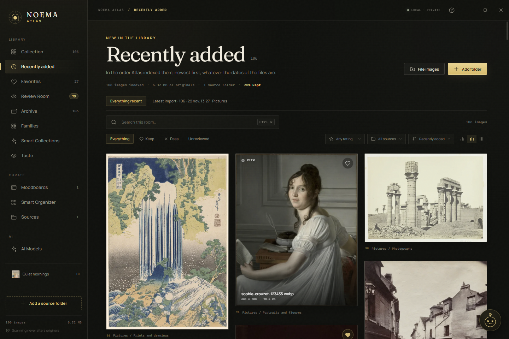

### Searching

Press `Ctrl+K` to search by file name, folder or tag. With the optional AI on you can also search by what a picture **looks like** ("a lonely
house in fog", "ett öga i ett landskap"), and use **Find similar** in the viewer.

---

## 5. Finding pictures you did not know you had

**Sources → Find pictures on this computer** looks through a drive for folders that contain pictures. It:

- is read-only (it only looks at names and sizes);
- skips system folders, programs, caches and icons;
- shows you the folders it found, with previews, **before anything is added**;
- adds only the folders you tick.

Afterwards the confirmation message offers **View newly added pictures**, which opens **Recently added** on that import.

---

## 6. Organizing: moodboards, groups, copying and moving

### Moodboards

A moodboard is an open canvas for a project. Create one (**Moodboards → New**), choose **Add from library**, and drag pictures where you
want them. Scroll to zoom, hold `Space` and drag to pan, and press **Fit all** to see everything. Pictures keep their proportions when you
resize them. **Tidy** arranges a messy board, and the Companion can suggest removing near-duplicates (you see before and after, and can undo).

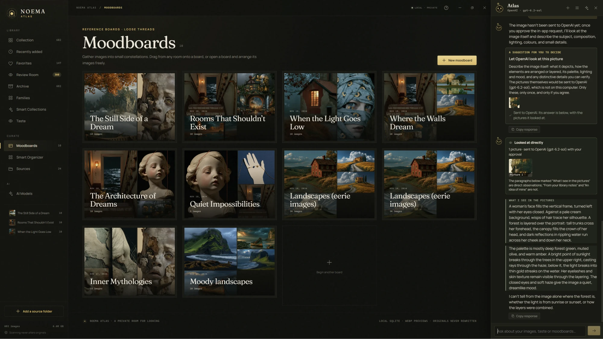

**Creative Moodboards — turn your images into new creative directions.** Bring pictures together, explore visual connections and develop ideas through freely arranged moodboards.

### Families and Smart Collections (optional AI)

With the optional AI on, **Families** groups pictures that look alike and gives each group a name from what its pictures share. Names are
the model's best guess: good for clear subjects, weaker for historical art or mixed material, so you can rename any family. **Smart
Collections** gathers pictures from a description you write ("teal-toned surreal portraits"); they update by themselves as your library grows.

### Two ways to put pictures in order on disk

| | File Room | Smart Organizer |
|---|---|---|
| Good for | Quickly filing keepers (or rejects) into one folder | Sorting a large, messy library into a proposed folder structure |
| Where | **File images** button in Collection/Archive | **Smart Organizer** in the left menu |
| How you choose | By Keep/Pass/stars, or by hand | By ticking the **groups** Atlas proposes |
| Copy | Yes (the default) | Yes |
| Move | Yes, with a confirmation | Yes, with a preview and confirmation |

Both keep your library information (favorites, ratings, moodboards, version links) with a picture when you **move** it.

### The Smart Organizer, step by step

The Smart Organizer reads your pictures, separates finished artwork from photographs, screenshots and experiments, groups them by subject,
finds copies and versions, and proposes folders. **Reading and proposing change nothing on disk.**

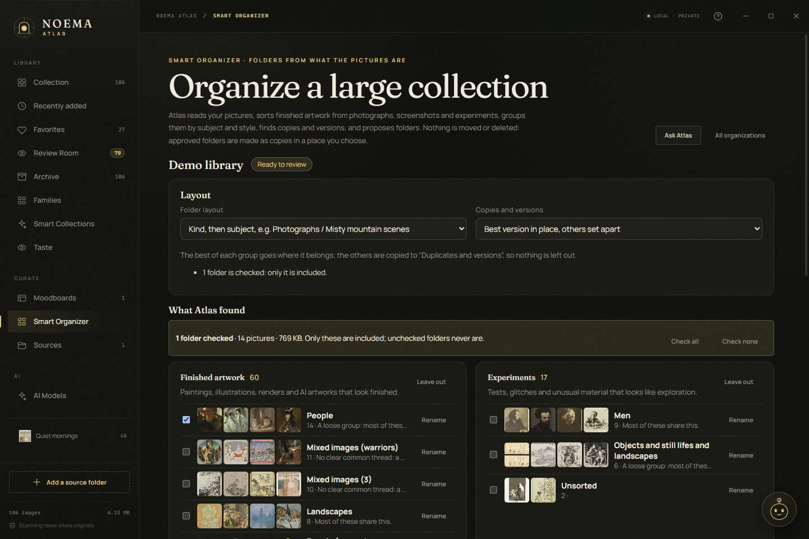

1. **Start.** Open **Smart Organizer** and choose what to read (the whole library or some sources), a **folder layout** (for example "Kind,
   then subject") and what to do with **copies and versions** (keep the best in place and set the rest apart, keep only the best, or keep
   all together). It works in the background and you can pause it or close Atlas; it continues where it stopped.
2. **Review.** Atlas shows what it found: kinds of pictures, each with proposed folders and a few sample pictures. You can **rename** a folder,
   **merge** folders, **leave out** a whole kind, or **add your own category** ("cats and kittens").
   Click any thumbnail to look at that group's pictures in the viewer; looking never changes your choices.
3. **Choose what to include.** Every folder has a **checkbox**. *Only the folders you tick are included.* **Nothing ticked means nothing is
   selected**: Copy and Move stay switched off until you tick at least one folder or press **Check all**. (Unticked folders are never
   included.)
4. **Copy or Move.**
   - **Copy** makes new copies in a folder you choose; the originals stay where they are.
   - **Move** relocates the originals into that folder. Atlas keeps each picture's favorite mark, rating, tags, moodboards and version
     links, because it updates the library to follow the file.
5. **Preview.** Before anything happens you see how many files, how many bytes, the free space at the destination, and every file's
   old and new place. If two pictures would get the same name, or a different file with that name is already at the destination, the new
   one gets a number (`photo (2).png`); **nothing is ever overwritten**.
6. **Confirm.** The button says exactly what will happen ("Move 7 files"). After you confirm, Atlas shows progress, and a **report** at the end.

Good to know about **Move**:

- Moving within one drive is a quick rename. Moving to another drive copies each file, compares it byte for byte, updates the library, and only
  then removes the old file. If anything fails, the original is left alone and the report says so.
- If Atlas is closed in the middle, open it and press **Continue**; every step can be repeated safely.
- A picture whose original has disappeared is reported and skipped.
- The destination folder becomes a source in your library, so the moved pictures stay visible.

**Tip:** try the Smart Organizer with **Copy** on a small group first, to see how it names and arranges things.

---

## 7. Creative features

### Taste: discover art you might love

The **Taste** room keeps two separate, honest profiles: what your **favorites** have in common, and what you discover by **comparing
works** from a built-in collection of 1,162 public-domain artworks from many traditions. It never judges your pictures and says how thin or
strong its evidence is. **Journeys** are personal exhibitions that start from something you already respond to and then stretch beyond it.
It works offline.

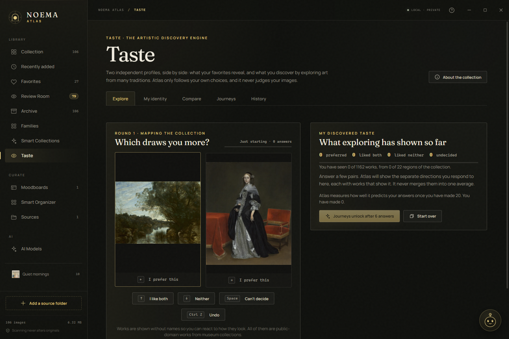

### The Atlas Companion

The little character in the corner (or `Ctrl+J`) opens a conversation with Atlas, who knows your library. Ask things such as "Find my most
atmospheric landscape images", "What do my favorites have in common?" or "Organize my pictures". Answers are marked **From your library**
(measured) or **An idea of mine** (suggestion). Atlas **never changes anything by itself**; it shows a proposal you accept or decline.
Without any language model it uses its built-in *Atlas basics*, which work offline for the tasks above. For open conversation you can
connect a language model (chapter 8).

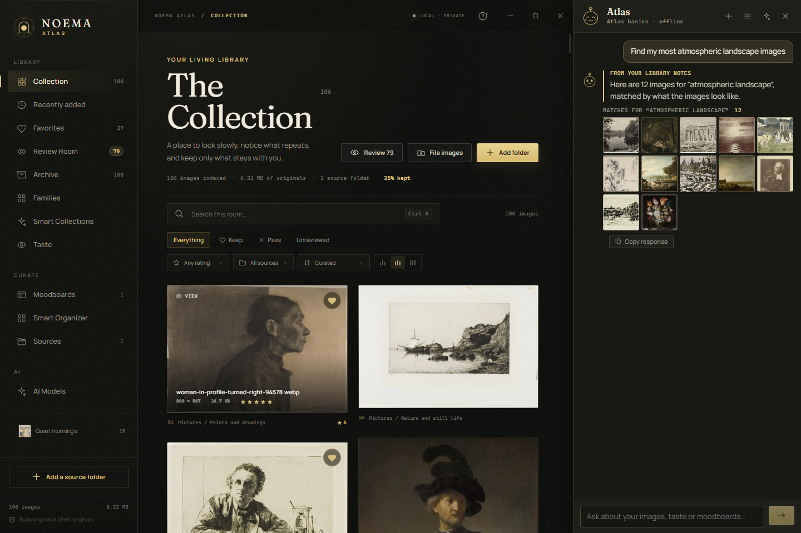

You can also open the Companion while looking at a picture; it then knows which picture you mean (it is told the name only, never the pixels).

### The Creative Studio

From a moodboard, press **Create artwork**: say which pictures give the mood, composition, colours and subject, and what you want. Atlas builds
a concept and a prompt you can read and edit, shows the price (if any) *before* it starts, and brings the result back into your library as a
new picture linked to its moodboard and sources.

- **Atlas Blend** needs nothing extra: a colour-and-composition study built from your references.
- **ComfyUI** (free, on your computer) and **cloud services** are optional; see chapter 8.
- **Edit…** changes a picture by description; you get a preview first and the result is saved as a **new version**. The original is untouched.
- **Edit in another program** (for example GIMP or Photoshop): Atlas opens a copy; when you save there, the result comes back as a new linked
  version, with a **Compare before/after** view.

### Retouch

**Retouch** works on a picture with a brush: **Remove**, **Heal**, **Blur**, **Sharpen** and **Dodge & burn**. Paint over a part, see the result at
once, compare with the original using the slider, and **Keep as a new version**. Nothing is saved until you keep it and the original is never changed.

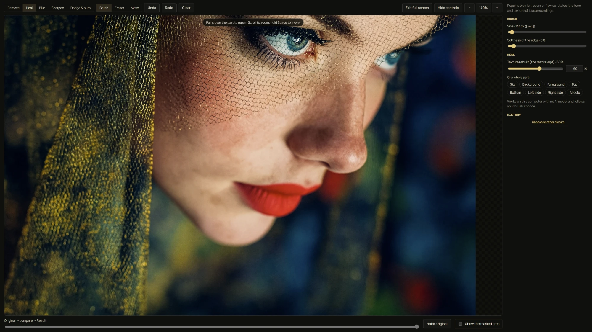

**Precision Retouching — refine the details, preserve the original.** Remove unwanted details, heal imperfections, soften, sharpen and adjust light with intuitive local tools. Compare your changes while keeping the original untouched.

How it behaves:

- Each finished edit is **locked in** with its own marking and settings. Changing tool or brush later never alters an edit that is finished.
  Switch tool, or press **Lock in this edit and continue**, to finish one.
- **Undo** and **Redo** go one stroke, then one finished edit, at a time.
- **Remove** works one removal at a time. After a removal, **Start a new removal** keeps it and clears the marking; **Retry this area**
  tries the same marking again.
- Blur strength can be typed (0.5–100 %); a few percent is often enough.
- **Full screen** gives the picture the whole window.
- Remove and Heal rebuild texture from around the mark. They are good for small marks and repeating textures. They cannot invent a face or other
  unique detail; for large objects, ComfyUI inpainting can help.

---

## 8. Optional AI: what it is and how to set it up

Everything here is **optional and off by default**. Atlas never needs an account.

### 8.1 The local image model (search by look, families, taste)

- A small model called SigLIP, about 390 MB, downloaded once from Hugging Face after you press Download.
- It runs on your computer (using your graphics card if there is one). Pictures, previews and search text are never uploaded.
- It enables: **Looks like** search, **Find similar**, **Families**, **Smart Collections** (mood), and the Smart Organizer's kind and subject grouping.
- Change your mind: **Sources → Image intelligence** lets you turn it off, pause learning, or **Remove model**.

If you have no internet, copy the four model files into `%APPDATA%\NOEMA Atlas\models\siglip-base-patch16-224\` and restart Atlas (the file names
are in the project's README).

### 8.2 A language model for the Companion (open conversation)

Open the Companion, then its settings. You can connect:

- a model **on your computer** (Ollama, LM Studio or any local server) — nothing leaves your computer;
- **your own API key** for Claude (Anthropic), OpenAI or an OpenAI-compatible service. Atlas first shows exactly what would be shared (text
  descriptions of your library; never picture files or file paths unless you allow it) and asks for your agreement. Cloud services may charge you.
  Keys are stored encrypted with your Windows account.

Pictures themselves are sent to a model **only** if you press Accept on a request that names the pictures and the provider, and only those pictures,
once. A model on your own computer receives them immediately and they never leave it.

### 8.3 ComfyUI (make and edit pictures with models on your computer)

ComfyUI is a free program many people use to run image models. Atlas can use **your own existing ComfyUI**: choose its folder once and Atlas finds your
models and workflows. Atlas reads your installation and **never changes it**. It can also set up its own separate copy for you (a large download, shown
with sizes and checksums before you agree). On Windows on Arm, Atlas shows the official instructions instead of installing for you.

Tested: running reference-picture generation with FLUX.2 [klein] on an NVIDIA RTX 2080 (8 GB), and a stand-in ComfyUI server for the rest of the workflow.
Not tested: AMD or Intel graphics, RTX 50-series, Windows on Arm.

### 8.4 The AI Model Library

Open **AI Models** in the left menu. It lists optional models, says whether each fits **this computer** (graphics memory and type), whether Atlas has
actually tested it ("Tested and verified") or it is only documented ("Documented, not tested"), its licence, and its download size. A model you already
have shows "Ready"; nothing is downloaded until you tick the agreement and press Install. "Preview of another computer" is only a preview, never a test.

### 8.5 Paid cloud pictures

An optional cloud method (OpenAI images) needs your key, shows the price first, asks every time, and respects a monthly limit you set. This was
checked for what it shows and asks, but **not** against a live paid service.

---

## 9. Backup, restore and moving to another computer

Atlas keeps your catalogue (ratings, favorites, tags, moodboards, taste profiles, history) here:

```
%APPDATA%\NOEMA Atlas\
```

**To make a backup:** close Atlas, then copy

1. the whole `%APPDATA%\NOEMA Atlas` folder (the **Sources** page has an **Open data folder** button),
2. your picture folders (Atlas never copies your originals),
3. the `NOEMA Atlas Studio` folder inside your Pictures folder (pictures made or edited in the Studio).

**To restore** (or move to a new computer): install/copy Atlas, close it, copy those folders back **keeping the same folder paths** for your
pictures, then start Atlas. If a picture sits in a different place now, Atlas marks it *missing* until you put it back or add its new folder.

Atlas also saves a snapshot of the catalogue before it upgrades the database to a newer version (`backups` inside the data folder).

---

## 10. Troubleshooting

| Problem | What to do |
|---|---|
| Windows says "Windows protected your PC" | The program is unsigned. Click **More info → Run anyway**. Check the SHA-256 fingerprint if you want to be sure. |
| It does not start, or a `.dll` is missing | Install Microsoft's Visual C++ Redistributable (x64), then try again. |
| The first start is slow | Normal: the portable file unpacks itself. Later starts are faster. |
| A folder shows no pictures | Atlas reads PNG, JPG, WebP, GIF, BMP, TIFF, AVIF and SVG, in sub-folders too. Add pictures, wait a few seconds, or press **Rescan**. |
| New pictures do not appear | Press **Rescan** on **Sources**. (Some network folders and disconnected drives cannot be watched.) |
| "Original missing" on a picture | The file was moved or deleted outside Atlas. Put it back, or add its new folder. Use the File Room or the Smart Organizer's **Move** when you want the library to follow a file. |
| Pictures look blank | Wait while previews are made. If it persists, **Sources → Rescan**. |
| Search by description does nothing | It needs the optional image model: **Sources → Image intelligence → Set up**. |
| The model download fails | Check your connection, then **Try again**; a partial download is resumed. Or use the offline install (8.1). |
| Copy and Move are greyed out in the Smart Organizer | Nothing is ticked. Tick a folder, or press **Check all**. |
| Something looks wrong after a crash | Atlas saves progress as it goes and continues unfinished work. Notes are written to `%APPDATA%\NOEMA Atlas\logs\main.log`; crash dumps stay on your computer in `crash-dumps` and are never uploaded. |
| I want to start over | Close Atlas and rename `%APPDATA%\NOEMA Atlas`. Your pictures are not touched. |

---

## 11. Privacy in plain words

- Your pictures stay where they are. Previews and notes live in your Windows user folder.
- Atlas has **no accounts, no ads and no tracking**.
- By default the only network use is the model download **you** start. Other network use happens only when **you** connect a service (a cloud
  language model, a network ComfyUI server, paid picture generation) and agree to what is sent.
- Crash information stays on your computer.
- The optional Windows AI runtime (ONNX Runtime) includes Microsoft diagnostics. Atlas switches its telemetry off before loading it. We have not
  inspected network traffic ourselves, so we do not claim more than that.

---

## 12. Keyboard shortcuts

| Key | Action |
|---|---|
| `Ctrl+K` | Search |
| `Ctrl+O` | Add a source folder |
| `Ctrl+J` | Open or close the Companion (also while viewing a picture) |
| `←` `→` | Previous / next picture |
| `F` | Keep (favorite) the open picture; in Retouch, full screen |
| `1`–`5` | Rate |
| `X` | Pass (Review Room) |
| `Ctrl+Z` | Undo (Review Room decisions; Retouch strokes and edits) |
| `T` | Jump to the tag field in the viewer |
| `E` | Show the original in Explorer |
| `Space` + drag | Pan a moodboard |
| `Esc` | Close the viewer, dialog or room |
| `?` | Short in-app guide |

---

## 13. What has been tested, and the limits

Atlas was tested on one Windows 11 computer with an NVIDIA RTX 2080 and 32 GB of memory, including a restart-and-recover test after forcing
the program to stop in the middle of work, restoring a backup, and an independent review before release.

**Not tested, so not promised:**

- Computers other than the one above; a fresh Windows installation; company-managed computers; SmartScreen behaviour for other people.
- Libraries of hundreds of thousands of pictures, and very large single pictures.
- Adobe Photoshop (GIMP was tested for editing in another program) and PhotoCraft.
- **Paid cloud picture generation** (OpenAI image models in the Creative Studio): only the request format, the price display and the monthly limit were checked by automated tests; no live paid job was run. Other cloud language-model providers were not tried individually.
- One automated Retouch test that runs a real ComfyUI removal on the graphics card crashed its test page once during release testing while the computer was heavily loaded, and passed on the next run. The cause was not established. If Remove with ComfyUI ever closes the window, please report it.

**Tested, with a cloud service:** the Companion looking at pictures you approve, through your own OpenAI account (a real OpenAI model, with the consent step shown before anything leaves your computer).
- AMD and Intel graphics, RTX 50-series and Windows on Arm for the optional AI.
- Removable and network drives disconnecting during a move.

**Good to know:**

- The program is unsigned (Windows warning, chapter 2).
- The AI's names and groups are suggestions and can be wrong; every one can be renamed.
- Some creative edits use a lot of memory on very large pictures.
- Atlas's text in the Smart Organizer page and the Sources page still describes filing as copy-only in places; **Move** exists in both the File Room and
  the Smart Organizer, as described in chapter 6.
- Keep your own backups of your pictures. Atlas protects originals carefully, but no software should be your only copy.

Atlas is free, open software under the MIT licence (Copyright © 2026 Patrick Karlsson; NOEMA is the project and product name). The reference artworks come from the Cleveland Museum of Art and the Art Institute of Chicago
(open access, CC0). Details are in `THIRD-PARTY-NOTICES.md`.
